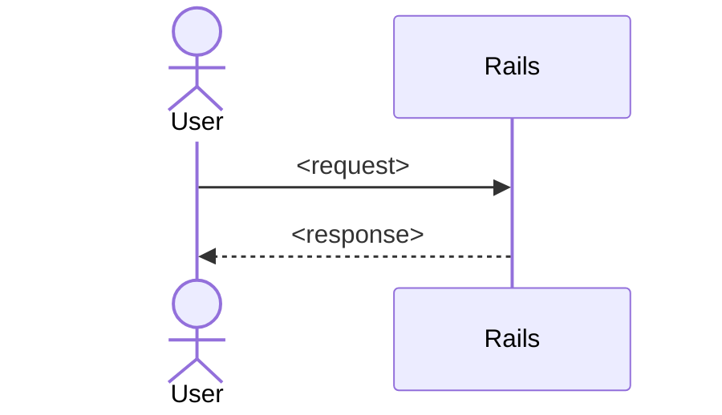

# RFC-<XXXX>: <Title>

- **Status:** Draft
- **Author:** rfc-author agent, refined with <human>
- **Created:** <YYYY-MM-DD>
- **Roadmap Milestone:** <milestone from ROADMAP.md, or "none">

## Context & Objectives
<Why are we building this? What user or business problem does it solve? 2–4 bullet objectives.>

## Non-Goals
<What this RFC explicitly does not cover.>

## Proposed Architecture
<System design in Rails terms: models, controllers, routes, views/Turbo, Stimulus, jobs.>

## Data Model & API Changes
### Migrations
| Table | Change | Constraints / Indexes |
| --- | --- | --- |
| `<table>` | <add column / new table> | <null: false, FK, unique index> |

### Routes & Endpoints
| Verb | Path | Controller#action | Notes |
| --- | --- | --- | --- |
| GET | `/<path>` | `<controller>#<action>` | <auth, format> |

## UX
<Screens and flows affected, including empty, loading, error, and permission-denied states. Reference DESIGN_SYSTEM.md components.>

## Security Considerations
<Auth/authz, data isolation, input handling, secrets, rate limiting.>

## Performance Considerations
<Query patterns, indexes, N+1 risks, background jobs, caching, expected load.>

## Rollout
<Feature flag? Migration ordering? Backfills? Rollback plan.>

## Alternatives Considered
<Each alternative and why it was rejected.>

## Acceptance Criteria
- [ ] <Verifiable outcome the Agile PM can turn into story DoD items>

## Open Questions
- <Question for the human or the Design Review Committee>
